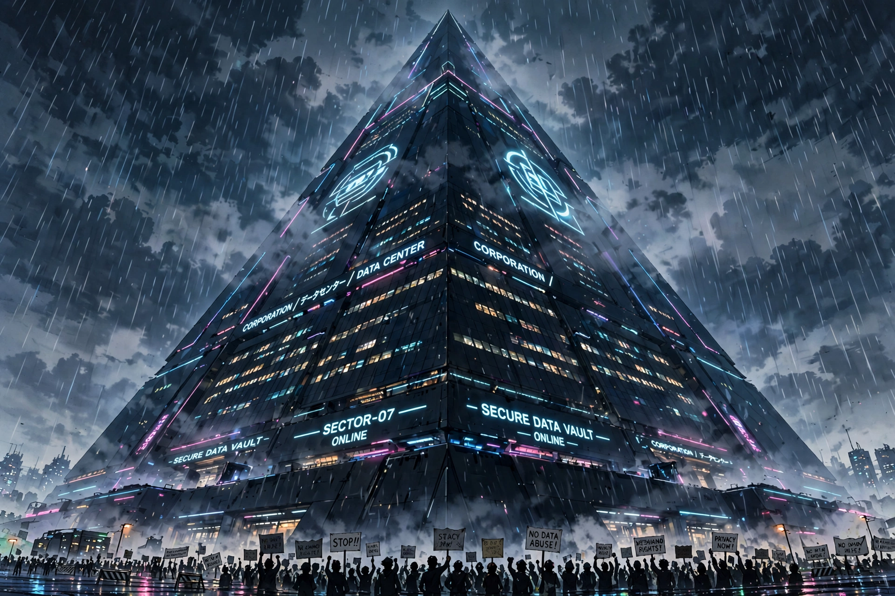

The recent (November 2026) mid-term election resulted in a Democrat clean sweep and put them in control of the US congress. This is widely regarded as a verdict against data-centers. 

The often cited reasons for the popular opposition are **water usage** and **electricity prices**. Both of them are dubious if one digs deeper. 

Water used in data-centers is for cooling and is **circulated** not **consumed** . Soybean farming consumes more water per dollar of revenue than data-centers by several orders of magnitude. 

The waiting time for a grid connection is on the order of several years. Most data-centers are generating power themselves.

In fact, in several locations, the arrival of data-centers has resulted in a substantial savings in property taxes as the taxes and fees paid by the datacenter companies has filled the coffers of these towns.

The only reasonable objection could be noise but this cannot be the reason behind a huge anti-incumbency wave that put the Democrats back in power.

I think there is a much more powerful underlying reason for the hate towards data-centers. 

**It is fear.**
### Why fear Data-centers?
Data-centers are the physical embodiment of AI(Artificial Intelligence). This makes them easy targets for fears that go beyond the physical or real-world impact of having a giant computer in a town. 

So, it is not *Data-center hate* but *Data-center fear*. 
It is not actually *Data-center fear* but ***AI fear***.

### Why fear AI?
The usual slogan that summarizes the fear of AI is 

>'AI will take our jobs'

A very valid fear. But it is quite shallow. In this article I try to show that it goes beyond a livelihood disruption fear to something existential. Something that is core to being human.

## Dawn of Homo Sapiens - The Wise Ape

Intelligence is the defining feature of Homo Sapiens. We are not as strong as the strongest animal nor as large or fast or have superior vision or hearing. Yet, we are the apex species on this planet and have remained so for thousands of years. Unchallenged. The only threat to our existence is ourselves.(until now at least).

### Before the written word
Pre-civilization i.e. defined as the emergence of settled life and written language, intelligence was distributed. 

Every human carried a peta-flop supercomputer in their skulls, and it was fully owned and most importantly it was secure and private, i.e. there was no i/o access other than through a very low band width port i.e. the mouth with 40 bits per second. 
Input was vastly higher as the visual field has very high bandwidth 10 Million bits per second. 

Every group of humans had their smartest person. These spikes in intelligence in the human population was randomly distributed. 

Having an intelligent person in the group in a particular generation did not ensure that more intelligent people will appear in the same group in subsequent generations. 

i.e. no accumulation, no scaling, no sustained advantage. Intelligence was isolated, situational, transient and memoryless.

### Civilization - emergent intelligence
Settled life and writing mark the beginnings of civilization. The earliest civilizations - Mesopotamia, Indus Valley were city states. 

Cities brought together a large population of humans together. Several orders of magnitude larger than a band of hunter-gatherers. This, along with the invention of writing unlocked a revolution in human intelligence.

First is the emergence of a network. A low band-width network in the form of conversations, debates, writing etc. but a network nevertheless. The intelligence of the network i.e. the City State as a whole is much greater than any particular individual. 

As a result, these ancient cities became a hot-bed of innovations - Metallurgy, Farming, Irrigation, Crop-selection, Domestication of animals, trade, governments, laws etc. 

The most important aspect of this is the **concentration of intelligence**. Cities were the locations where everything happened. It was the seat of power, commerce and innovation.

A child growing up in the city had far greater intelligence or the ability to leverage the network of intelligence than a 'country bumpkin' - the very existence of this phrase is proof that this difference was quite evident culturally.

The key point to note is that power and control had to locate itself in the largest populated center of the kingdom or nation-state as that was the only way to leverage and more importantly control the intelligence.

### OK Computer
Fast-forward to the information age around the 1940s. Computers became a powerful tool that scaled human intelligence and it was used extensively in the second world war. Computing was in the domain of the military and access was strictly controlled. 

But then the tide turned. The era of the personal computer was among us. Perhaps the consequence of the flower-power movements in the 70s. Common man now had access to computing even though less powerful than the military ones.

The most important aspect was that it was most importantly personal. It's in the name - **Personal Computer**.

### Connected
The very early days of the internet were no different from the primitive era of man. The information was shareable but the bandwidth was quite low. 

However, the major difference was the range of such connections. It could technically span the entire globe.

In the 90s and the early 2000s there was great hope that the internet truly democratized intelligence. The very first thing the internet did in the early days was to **commoditize Knowledge**. 
Wikipedia put the collective knowledge of the entire human race at the fingertips of every human **for free!!!**

Intelligence was still in the hands of humans and for the first time in history, knowledge work became an important profession. The biggest benefactors being Software Engineers.

With the internet the heat-map of intelligence which was highly concentrated in cities and especially cities in the developed world now began to dissipate. This meant that people in the developing world could work on projects around the world i.e. **Outsourcing**

### God in the Machine
What started in a humble domain of statistical modeling soon grew up into a specialized field called Artificial Intelligence (AI). Like all technology , the transistor for example, the early versions were comically inept.

Without going into the history of AI development let's fast-forward to now. Scaling laws of AI kicked in around 2022-2023 and as of this writing (2026) are showing no signs of abating.

Scaling here mostly refers to the scale of the hardware used to build and run these AI systems called 'models'.

>For the first time since the advent of computers there was a consumer software that cannot be run on an individual's computer.

AI was trained on human generated data and  has completely surpassed humans in the domain of knowledge work, specifically Software Engineering(as of this writing). The laptop class peaked in 2020 post-pandemic. [The present and the future is not rosy to put it mildly](https://happypathfire.com/post/rip-coding/).

>Intelligence or to be more precise, human intelligence is mostly commoditized and is rapidly converging on achieving this across all domains.

The key point is that the intelligence is now completely centralized. The scaling required to build and run frontier models is in the order of 10s of Billions of dollars. Way beyond the reach of the vast majority of people.

### Data center of geniuses
'A data center of geniuses' from [Dario's blogpost](https://darioamodei.com/essay/the-adolescence-of-technology) is a highly relevant phrase.

The human share of the entire intelligence on the planet is diminishing rapidly as the capability and scale of the AI models keeps increasing.

A single 10GW AI hyper-scaler datacener is equivalent to several million highly skilled programmers, data-analysts, project managers etc.

The current pipeline indicates 100s of GWs of contracted capacity coming online over the next 5 years, and beyond. There are talks to hyper-scalers putting down TWH i.e. 1000 GW datacenters.

A heat map of the world has reverted to not just concentration to the levels seen during the emergence of City states during the ancient times but something even more extreme.
Its not just the numerical concentration of intelligence but of the levels of intelligence too that is scaling.
A weighted heat-map of intelligence on planet earth shows simple and single point source of all intelligence. 

Access to this is [capitalistic](https://happypathfire.com/post/rip-coding/), i.e. if you can afford the tokens then you can access intelligence. 

>The democratic and fair distribution of intelligence which nature distributed far and wide is now gated and tolled.

The more access to this intelligence one has, the more productive they can be, leading to higher economic growth, leading to greater accumulation of capital and greater ability to scale intelligence with no cap.

Although Elon's ideas may sound crazy, he is wrong only in his timelines but never in direction. A space based datacenter has almost limitless scaling potential. 100s of TWH. This will result in the sum total of distributed human intelligence on the planet a rounding error.

### A symbol of consequential doom

Data-centers are the physical representation of this complex situation. **A specie level identity crisis**.

Man without intelligence is a weak animal, it was intelligence that allowed us to rise above the animal world to become the apex predator. This kind of disenfranchisement from intelligence will have consequences.
The world of *the haves and have-nots* will be based on something far more basic than basic resources of food clothing and shelter. It will be the ones with access to intelligence and the ones who dont.

ASI - Artificial Super-intelligence is in the realm of possibilities based on the consensus view of the experts in the domain with the only debate being on the timelines. 

If true then intelligence will become point source with infinite take-of. What will such a world look like? and how does man relate to himself and other men in such a world is hard to imagine.

Homo Sapiens had a good run. Now we can no longer confidently claim to be at the apex of intelligence on the planet. A valid fear that we have to process collectively as a specie. Protesting at the Data-center may not be the right answer.